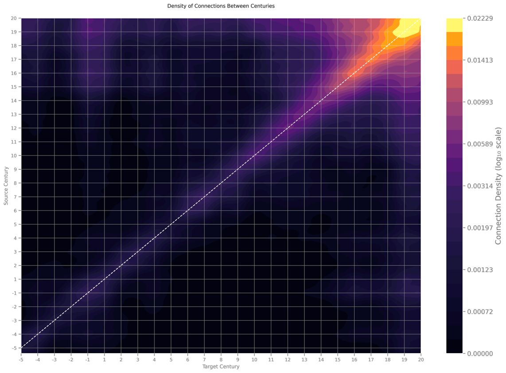
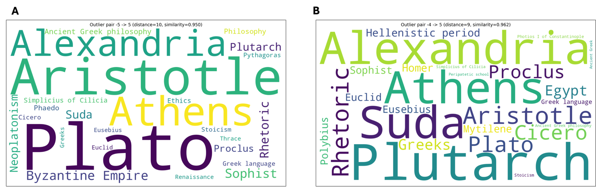

# Network and Semantic Patterns in Wikipedia's Network of Biographies

## Background

The previous section (*Results -- section [3.1.2](#results)*), using
complex network methods, characterised the cultural network of Art,
Science, and Philosophy within the 17^th^ century alone. The present
section complements this approach to a substantially broader scope, both
temporal and disciplinary. Two methodological choices make this
complementary step possible. First, WikiTextGraph (see *Methodology -
[WikiTextGraph](#wikitextgraph)*) parses and processes Wikipedia data at
scale. Second, a series of filtering steps yields a dataset of
approximately 1.9 million biographical pages, classified into Fields of
Human Activity (FHA) (see *Methodology - [Biographical Network
Construction](#biographical-network-construction)*). This section first
reviews the relevant literature and then identifies the research gap
that the present analysis addresses.

A growing body of work applies network-based methods to cultural and
historical phenomena at scale, and Wikipedia has emerged as one of the
most frequently examined repositories within this tradition. Early
studies in this area used network centrality metrics on biographical
articles to identify the most prominent historical figures across
language editions. Their findings reveal a consistent pattern: locally
celebrated individuals coexist with a smaller set of globally recognised
figures [@Miccio2025Wikipedia; @Aragon2012Biographical; @Eom2015Interactions; @Eom2013Highlighting]. This pattern points to the layered character of
cultural prominence, in which local and global recognition operate as
distinct but coexisting dimensions. Within this first body of work,
disciplinary case studies of mathematicians [@Chen2019Analysis] and philosophers [@Rollin2025Most]
further show that structural indicators of importance, such as in-degree
or PageRank scores, remain largely stable over time. Combining
disciplinary focus with temporal dynamics, a smaller set of studies
documents recency biases and temporal homophily but also some shifts in
historical prominence over short periods [@Jatowt2016Digital; @Goldfarb2015Quantifying]. More recent work
extends this perspective by examining cross-field connections in the
17th century and identifying individuals who bridge distinct
intellectual areas [@Schwartz2021Complex; @Miccio2022Mapping; @Brown2016Preliminaries]. Collectively, these studies establish that
network-based approaches are well suited to mapping the relational
structure of cultural networks, and of Wikipedia in particular. However,
two limitations emerge: the temporal window of analysis is typically
narrow, and the focus tends to be restricted to specific disciplines.
The analysis presented here addresses both limitations by extending the
temporal window to 25 centuries, from the 5th century BCE to the 20th
century CE, and by covering multiple FHAs.

A limitation of a different sort, shared by the network-based studies
reviewed above is that they treat connections between cultural entities
as structural, defined by their position within the network topology.
However, the meaning of a link between two biographical figures also
depends on the conceptual context in which that link appears. A node
connected to many others occupies a structurally central position, but
this alone does not reveal whether those connections reflect shared
intellectual tradition, institutional proximity, or disciplinary
overlap. Recovering that distinction requires attending to the semantic
content of the links, not only their topology. A representative example
of this integrated approach is the work of Sangiacomo et al. [@Sangiacomo2022Recreating], who
reconstruct the network of early modern natural philosophy by combining
vectorised textual representations with network techniques, thereby
coupling the structural and semantic dimensions of intellectual
exchange. The present analysis adopts a similar framework. As detailed
in the [*Methodology*](#methodology), the second part of the analysis
applies semantic embeddings to the wikilinks that compose the
biographical network. This combined approach allows the structural
patterns identified through network analysis to be examined alongside
the semantic contexts in which they are embedded, rather than treating
the two points of view as separate phenomena.

The use of embeddings to analyse cultural data connects to a broader
methodological tradition known as cultural cartography. Within this
tradition, word embeddings are used to construct a high-dimensional
mathematical space in which the meaning of a word or concept is defined
by its position relative to all other words [@Kozlowski2019Geometry]. To put this in
simple terms: words that appear in similar contexts across large bodies
of text end up positioned close together in this space, while
conceptually distant words are placed far apart. By projecting vast
amounts of text into this geometric representation, cultural cartography
translates complex cultural relationships into a form that can be
systematically measured and compared. Lee and Martin [@Lee2015Coding] characterise
the resulting representations as "impoverished but intersubjectively
valid", meaning that while some nuance is inevitably lost in the
translation, the simplified map remains meaningful across different
observers and interpretive contexts. Beyond static mapping, a second
strand of this literature examines how the positions of words and
concepts shift over time. Hamilton et al. [@Hamilton2016Diachronic] demonstrate that, while
words carrying cultural markers of social status were in constant flux
throughout the 20th century, the underlying dimensional structure of
class remained stable. This finding is important because it shows that
surface-level semantic change does not necessarily indicate structural
transformation. Further work in this strand has tracked historical
shifts in gender and ethnic stereotypes [@Garg2018Word], revealing how culturally
embedded associations evolve across periods.

The studies reviewed above that use embeddings to map cultural
phenomena, including the connectivity patterns of biographical networks,
predominantly rely on static word embeddings. In this approach, each
word or concept is assigned a single fixed vector regardless of the
context in which it appears. This works well for capturing broad
semantic regularities, but it cannot distinguish between different uses
of the same term. The word "revolution," for instance, carries a
different meaning in a biography of a political leader than in the
biography of a physicist, yet a static embedding assigns both
occurrences the same position in semantic space. The present study makes
use of contextual embeddings to embed outgoing links of Wikipedia
biographical pages, which generate a distinct vector for each occurrence
of a link depending on its surrounding links. The use of contextual
embeddings has been shown to capture finer-grained semantic distinctions
than static representations [@Deb2022Comparative; @Ethayarajh2019How; @Liu2024Comparative]. Adopting contextual embeddings
within a cultural cartography framework extends the existing literature
in two directions. First, it preserves the macroscopic, map-like
perspective characteristic of this tradition, allowing large-scale
cultural patterns to be observed across centuries. Second, it improves
the semantic resolution at which those patterns can be examined, making
it possible to detect more subtle shifts in how concepts are used across
time and discipline. Building on this improved resolution, the analysis
focuses on FHAs associated with knowledge production, particularly
Science and Philosophy, in order to trace how their conceptual
connections to other fields of human activity change across 25
centuries.

## Results

### Network Analysis

This subsection examines a biography-to-biography network in which nodes
represent aggregated biographical pages. Each node combines an FHA with
a century, meaning that the network operates at the level of
FHA-temporal clusters rather than that of discrete persons. Edges
between nodes were normalised through two complementary methods: an
outgoing-based normalisation, which accounts for the referential weight
of the source node, and an incoming-based normalisation, which reflects
the receptive weight of the target node. Together these two perspectives
allow connectivity patterns to be read from the perspective of influence
and that of reception, as explained in the Methodology section (see
*2.5.4. [Weight Normalisation & Network
Filtering](#weight-normalisation-network-filtering)*).

Following the analytical sequence established in the previous section
(see *Results -- section
[3.1](#wikipedia-as-a-cultural-lens-a-network-approach)*), this section
begins at the most aggregated level of observation: the temporal
structure of the biographical network as a whole. [Figure
23](#_Ref232589633) presents a kernel density estimation (KDE) of links
across centuries for all FHAs. A KDE plot is suitable for big data
visualisation because it shows the shape of the data's distribution as a
smooth curve, making it easy to see where values are concentrated and
where they are sparse [@VanderPlas2017Python]. The plot shows a relatively strong and
constant (without gaps) concentration of connections along the diagonal.
This means that biographical articles predominantly link to other
biographies of individuals born within the same or immediately adjacent
centuries. Quantitatively, 96.99% of all biographical links occur within
a one-century span, a level of temporal concentration not previously
demonstrated at this scale. Since the century bin is coarse and it can
conflate distances up to \~99 years, we move to the level of years. At
this level we see that the average temporal distance between linked
individuals is 33.78 years, a value that is of the same order as the
average human generational interval of 27 to 30 years reported in
demographic research [@Tremblay2000New; @Wang2023Human].

{width="6.138194444444444in"
height="4.525in"}

[]{#_Ref232589633 .anchor}**Figure 23** Cross-temporal connection
density between biographical subjects across source and target centuries
($\log_{10}$ scale).

This finding shows a pattern of temporal homophily, defined here as the
tendency of biographical pages to connect preferentially to individuals
born in temporally proximate periods. Moreover, the fact that this
result appears when considering a large number of biographies indicates
that it is a structural property of Wikipedia's biographical network.
While Jatowt *et al*. [@Jatowt2016Digital] previously identified this pattern, their
analysis was limited to a narrower time frame; the present study extends
it across 25 centuries and nearly two million biographies, demonstrating
that temporal homophily is not a period-specific feature but a general
organising principle of the network.

Two further observations can be made for this temporal homophily
pattern. The first one is regarding the 33.78-year average. The metric
is computed across all FHAs and the direction in this case does not
matter. That means that the result is an aggregation of a heterogeneous
set of relations, which can include kinship and dynastic ties, marriage,
succession in office, collaboration, rivalry, sporting partnership, etc.
[@Agapitos2025WikiTextGraph]. Each of these type of relations can independently connect
individuals whose active lives overlap within roughly one generation.
What the convergence with the demographic interval suggests is that the
link structure of Wikipedia registers the temporal radius of social
co-existence as refracted through the lens of encyclopaedic
documentation.

The second observation qualifies the strength of the diagonal pattern.
While 96.99% of biographical links fall within a one-century span, this
near-total temporal clustering does not mean that long-range connections
are absent. Such connections are statistically rare; however, as the
subsections that follow demonstrate, they are not randomly distributed.
Lastly, on the diagonal we observe that the link density increases from
the 15th century onward, reflecting both the expansion of Wikipedia's
biographical coverage in more recent periods and the well-documented
asymmetries in how the online encyclopaedia represents the recent past
relative to more distant eras.

#### Temporal Homophily within Specific Disciplinary Pairings

Within Science, 96.02% of biographical links fall within a one-century
span, close to the full-network figure of 96.99%. This proportion
declines once a link crosses a disciplinary boundary: 85.84% for links
running from Humanities & Philosophy to Science, and 91.46% in the
reverse direction. Based on these numerical insights, there are three
points that worth mentioning.

First, temporal homophily persists across disciplinary boundaries, but
it weakens in that context, so cross-field connections are where the
network's temporal coupling relaxes most within this comparison. The
relaxation is also asymmetric: links originating in Humanities &
Philosophy are more temporally dispersed than those originating in
Science (85.84% within one century, against 91.46% in the reverse
direction).

This dispersion is visible in the KDE plots (see **Figures
[24](#_Ref230883751)A-B**). More specifically, figure
[24](#_Ref230883751)A shows diffuse off-diagonal density, including a
pronounced cluster in the upper-left region where recent figures (source
≈ 19th--20th century) link back to Classical-era science (target ≈
5th--3rd century BCE). One plausible reading of that "hotspot", which
requires node-level inspection to confirm, is that modern philosophers
of science account for a substantial share of these links. On the other
hand, the plot for Science to Humanities & Philosophy remains more
tightly bound to the diagonal (see **Figure [24](#_Ref230883751)B**).

Reading Figure [24](#_Ref230883751)B more closely, three hotspots of
connections stand out. The first sits in the lower-left corner (source
and target both in the Classical era, roughly the 5^th^-3^rd^ century
BCE), where scientists of antiquity direct a large share of their
cross-field links to Humanities & Philosophy figures of the same period.
The second lies on the diagonal around the 5^th^ century CE, and the
third around the 11^th^-12^th^ century CE. Because the panel is
normalised by outgoing links, these cells indicate that scientists that
lived in those centuries concentrate a very high proportion of their
Humanities-directed links within a narrow contemporaneous band.

These three regions lie on or very close to the diagonal, which is
consistent with the temporal-homophily pattern reported above: even when
a link cross the disciplinary boundary, we see that it tends to stay
within roughly one century. What the hotspots add is that this
cross-field coupling is not temporally uniform as it becomes denser in
particular eras. With some caution, someone could read these as periods
in which the documented activity of scientists and of philosophers was
closely intertwined: late antiquity and the medieval period are both
eras in which natural philosophy and philosophy were not yet
institutionally separated, so an individual identified retrospectively
here as "Science" and one identified as "Humanities & Philosophy" may
describe figures working within a single intellectual milieu. This
reading should be viewed here as a hypothesis that the observed
structure is compatible with and not as a claim that the density per se
establishes. This is because to confirm that, it would require examining
the specific individuals in each cluster.

![[]{#_Ref230883751 .anchor}**Figure 24** Kernel density estimation
(KDE) plot of (**A**) in-degree--normalized cross-field links between
Humanities & Philosophy and Science across centuries and (**B**)
out-degree normalized between Science and Humanities & Philosophy.
Lighter shades indicate higher link
density.](media/media/image27.png){width="6.280803805774278in"
height="2.262752624671916in"}

#### Long-Range Connections and the Topological Bypass

The [*Introduction*](#introduction) established that Wikipedia's
network, as approached in this thesis, constitutes a cultural network
[@Schich2014Network]. A cultural network, even if the nodes are only biographical
pages of people, is not merely a social network. That means that the
time in biographical pages is not represented solely as a neutral
chronological sequence but rather as a socially constructed and
relational framework that follows the narrative and thus functions
across multiple dimensions [@Adam1994Time; @Sorokin1937Social]. That means that, even though
biographical pages are anchored to fixed temporal markers such as dates
of birth and death, their connection operate through narrative and
relational temporalities. That implies that the apparent temporal
distance in Wikipedia biographies can be shortened or lengthened
depending on the narrative structure, shared FHAs, or perceived
intellectual lineage [@Saraceno1989Time; @Brennecke2025Relational]^The English Wikipedia biography of Isaac Newton exemplifies this temporal expansion and compression. His entry contains outbound links to contemporaries such as Gottfried Wilhelm Leibniz, but also establishes direct connections to individuals from the distant past (e.g., Aristotle) and the Modern Era (e.g., the biographer Richard S. Westfall)., and it is this narrative-driven
connectivity that permits the existence of long-range links, either to
the past or to the future. As shown in the preceding section, these
long-range links constitute only a small fraction of the total.
Nevertheless, they are not randomly distributed. The way in which
biographies connect across centuries reveals something distinctive about
how specific historical periods are represented in Wikipedia and, by
extension, about how the encyclopaedia constructs its version of the
past.

Turning to the off-diagonal patterns, the analysis identifies a
recurrent feature across all examined pairings of FHAs: a pronounced
reduction in link density for biographies spanning the 6th to the 10th
centuries CE. In the KDE plots (see **Figures [24](#_Ref230883751),
[25](#_Ref230704910), and [26](#_Ref230704624)**), this appears as a
dark band running through the corresponding region of the matrix.
Because the sparsity is visible under both incoming and outgoing
normalisation schemes, it cannot be attributed to link directionality
alone; rather, it reflects the relative isolation of this period within
the network's topology.

![[]{#_Ref230704910 .anchor}**Figure 25** KDE plot of normalized
in-degree-based connections from Science (y-axis) to Science (x-axis);
this plot illustrates "Out of all the links that Target receives, what
is the fraction of links originating from
Source?"](media/media/image28.png){width="6.105136701662293in"
height="4.385080927384077in"}

To examine this pattern more closely, the analysis focuses on a more
specific directional question that spans the "isolated" period
identified above: how do scientists from the 8^th^ to the 20^th^
centuries CE link to figures from the Classical Era^[The general historical periods and their time windows used in this study are: Classical Era (5th BCE to 4th century CE), Middle Ages (5th to 14th CE), Early Modern Era (15th to 17th century CE), and Modern Era (18th to 20th century CE). It should be noted that this periodization is used only as a heuristic marker to facilitate the large-scale longitudinal comparison performed here. For this reason, it is important to acknowledge that these boundaries are only historiographical conventions and not absolute temporal containers [@Moretti2000Conjectures; @LeGoff2015Must].] (5^th^ century
BCE to 4^th^ century CE)? [Figure 25](#_Ref230704910) shows that
retrospective connections to Classical Era scientists appear as early as
the 8th century CE, increase markedly during the Renaissance, and then
decline modestly in the Modern Era. This trajectory is consistent with
what historians of science call the Continuity thesis (i.e., the
argument that the intellectual foundations of the Modern Era rested on
the sustained transmission and reinterpretation of Classical knowledge,
with medieval scholars serving as essential intermediaries [@Grant1996Foundations; @Hannam2010God].
The density of connections visible from the 8th century onwards
corresponds to the documented scope of the Islamic Translation Movement,
the large-scale effort to translate, adapt, and preserve Greek
scientific, philosophical, and medical texts into Arabic, undertaken
roughly between the 8th and 10th centuries CE [@ElGhazi2020Arabic; @Montgomery2018Mobilities; @Ragab2022Translation]. On this reading, the European Renaissance was not the origin of a reconnection
with Classical thought; the network renders it instead as the moment
when a much longer transmission process became especially concentrated
and visible, beginning from the 14th century onward.

Despite this evidence of continuity, a structural asymmetry emerges when
the two normalisation perspectives are compared directly. When looking
through the lens of the incoming normalisation^[Incoming normalisation asks: of all links a given century receives, what fraction originates from each source century?] (see [**Figure
25**](#_Ref230704910)), medieval scholars appear as connectors; they
receive links from Classical Era figures and send links forward to later
periods. However, through the lens of the outgoing normalisation^[Outgoing normalisation asks the reverse: of all links a given century sends out, what fraction goes to each target century?]
(see [**Figure 26**](#_Ref230704624)), Modern Era scientists tend to
link directly to Classical Era figures, bypassing medieval
intermediaries. The medieval contribution to the chain of transmission
becomes structurally less visible; not because they are absent from the
data, but because the outgoing perspective does not bring this
contribution to the foreground.

![[]{#_Ref230704624 .anchor}**Figure 26** KDE plot of normalized
out-degree based connections from Science (y-axis) to Science (x-axis);
lighter shades indicate higher link density. This plot can be read as
"Out of all the links that cluster Source sends out, what percentage
goes to cluster
Target?"](media/media/image29.png){width="6.268055555555556in"
height="4.499291338582677in"}

This asymmetry carries a specific significance for digital humanities
and studies that use computational approaches on knowledge repositories.
As presented in the [*Introduction*](#introduction), Wikipedia's link
structure does not only reflect historical information, but it also
reflects how contemporary editors document and connect this historical
information. The pattern visible under outgoing normalisation, in which
Modern Era scientists connect directly to Classical antecedents, is
consistent with a historiographical narrative in which the Renaissance
marks a rupture after a not so active medieval period and a rediscovery
of Antiquity through classical texts. This narrative has been
substantially revised by recent scholarship [@Grant1996Foundations; @Hannam2010God; @Miller2012Continuity; @Needham2020Getting], yet it
remains structurally visible in the network under the outgoing
normalisation perspective. This need not mean that individual editors
consciously reproduce a superseded view. It is more likely that widely
shared cultural framings of intellectual history leave measurable traces
in large-scale link structures as an emergent property of many
independent editorial decisions [@Easley2010Networks; @Smolla2019Cultural]. Lastly, this is the kind of
pattern that is difficult to detect through close reading of individual
articles but becomes visible at the network scale when data is
aggregated.

These results also point to a methodological consideration relevant to
anyone working with large digital repositories. As shown here, the
choice of normalisation direction is not a neutral technical step; it
determines which historical narrative the data makes legible. The same
network simultaneously supports a reading of historical continuity,
under incoming normalisation, and a reading of historical rupture, under
outgoing normalisation. It should be noted that neither reading is more
correct than the other, and neither can be derived from the data without
a prior interpretive choice about perspective. This is consistent with
the argument, developed within digital humanities, that quantitative
representations of cultural data always involve decisions that shape
what becomes visible [@Drucker2011Humanities]. In this thesis, this is not necessarily a
limitation but an analytical resource. As described in
[*Methodology*](#methodology), incoming and outgoing normalisation are
applied in a complementary manner precisely so that the narratives
encoded in Wikipedia's biographical network can be examined from both
directions.

### Embeddings Analysis

The preceding section established that biographical connections between
FHAs cluster overwhelmingly among contemporaries, with long-range links
forming a sparse, non-random layer above this dominant structure. What
network topology alone cannot reveal, however, is whether a comparable
temporal organisation governs the semantic contexts through which
biographical pages engage with the broader world: the concepts,
institutions, events, and artefacts that their outgoing links reference.
The embeddings analysis addresses this question directly. In keeping
with the approach taken above, the focus falls primarily on Science and
Humanities & Philosophy, while results across all FHAs combined are also
reported, whenever possible.

The analysis extends the embedding approach to the full corpus of
Wikipedia biographical articles, each grouped by FHA and century as in
the preceding subsection (see *3.2.1.1. [Network
Analysis](#network-analysis)*). Unlike the biographical network,
however, this analysis does not restrict outgoing links to connections
between persons; all outgoing links from each biographical article are
retained. The informational content of each FHA-century cluster is then
summarised through a centroid vector, computed as the mean of the
embedding vectors belonging to that group. This representation condenses
the semantic profile of each cluster into a single point in the
embedding space, aiming to map the conceptual cultural landscape of each
FHA and century as it is embedded in the outgoing links of Wikipedia.

#### Gradual Temporal Ordering in Semantic Space

The century-level centroid vectors for Science and for Humanities &
Philosophy and of all FHAs combined are projected into three dimensions
using Principal Component Analysis (PCA), a technique that is suitable
for big data visualisation since it reduces the dimensionality of the
embedding space while preserving the main axes of variation [@VanderPlas2017Python]. This
allows the relative positions of different centuries to be visualised
and compared.

![[]{#_Ref230872117 .anchor}**Figure 27** Visual representations of
century embeddings for Science. (**A**) A three-dimensional principal
component analysis (PCA) projection, where each point denotes a century
(negative values indicate BCE, positive values CE) positioned by the
first three principal components. Colors represent broad historical
periods. (**B**) A hierarchical clustering dendrogram for Science using
Ward's linkage and cosine distances, illustrating similarity
relationships between centuries without dimensional
reduction.](media/media/image30.png){width="6.156290463692039in"
height="3.63125in"}

In both projections (see **Figures [27](#_Ref230872117)A and
[28](#_Ref230872119)A**), the century centroids display a tendency
toward gradual temporal ordering, particularly over the last eleven
centuries, where temporally adjacent centuries tend to occupy relatively
close positions in the embedding space. At a broader scale, the
centroids also form partially overlapping clusters that correspond
closely to conventional historical periods: the Classical Era (5th
century BCE to 4th century CE), the Middle Ages (5th to 14th centuries),
the Early Modern Era (15th to 17th centuries), and the Modern Era (18th
to 20th centuries). It should be mentioned that these groupings are not
imposed by the analysis but emerge directly from the embedding
structure, without any predefined historical categorisation.

![[]{#_Ref230872119 .anchor}**Figure 28** Visual representations of
century embeddings for Humanities & Philosophy. (**A**)
Three-dimensional principal component analysis (PCA) projection, where
each point represents a century (negative values indicate BCE, positive
values CE) positioned by the first three principal components. Colors
indicate broad historical periods. (**B**) Hierarchical clustering
dendrogram for Humanities & Philosophy using Ward's linkage and cosine
distances, illustrating similarity relations between centuries without
dimensional
reduction.](media/media/image31.png){width="6.060977690288714in"
height="3.497916666666667in"}

![[]{#_Ref230874090 .anchor}**Figure 29** Visual representations of
century embeddings for all FHAs combined. (**A**) A three-dimensional
principal component analysis (PCA) projection, where each point
represents a century (negative values indicate BCE, positive values
indicate CE) positioned along the first three principal components.
Colors denote broad historical periods. (**B**) A hierarchical
clustering dendrogram for all FHAs combined using Ward's linkage and
cosine distances, illustrating similarity relationships between
centuries without dimensional
reduction.](media/media/image32.png){width="6.2675732720909885in"
height="3.7055194663167104in"}

Because PCA compresses high-dimensional data into a small number of
dimensions, there is a risk that the visual closeness of certain
centuries in the projected space is a by-product of the compression
itself, rather than evidence of genuine similarity in the original
embeddings. To rule out this possibility, the temporal patterns observed
in the PCA projection are subjected to a series of independent
verification steps.

The first verification applies hierarchical clustering, a method that
groups data points by progressively merging those that are most similar.
Importantly, this procedure is applied directly to the embeddings, not
to any reduced-dimensional representation, and it does not impose any
prior assumptions about how the centuries should be grouped. The result
is shown as a dendrogram, a tree-like diagram in which centuries judged
more similar are joined by shorter branches, while more distant ones
merge later through taller branches. If the dendrogram recovers
recognizable historical periods without being explicitly instructed to
do so, this provides independent evidence that the temporal signal is
present.

The second verification examines whether the known historical periods
(i.e., Classical Era, Middle Ages, Early Modern Era, and Modern Era)
correspond to genuinely distinct regions of the embedding space. Two
standard measures of cluster quality are used for this purpose. The
Silhouette Score captures, for each century, how closely it resembles
other centuries belonging to the same period compared to those in the
nearest neighbouring period; a high score indicates that the periods are
well separated. Additionally, the Calinski-Harabasz Score provides a
complementary perspective by comparing the spread of centuries within
each period to the spread between periods; again, a higher value
reflects cleaner separation.

The third and final verification asks whether the Silhouette Score
obtained could simply have arisen by chance, under a null model in which
period labels are randomly reassigned to centuries. To answer this, the
period labels are randomly reassigned to centuries a large number of
times, and the Silhouette Score^[The Silhouette Score measures how well each data point fits within its assigned cluster relative to neighbouring clusters. For each century, it computes the average dissimilarity to all other centuries in the same period and compares this to the average dissimilarity to centuries in the nearest other period. The resulting value ranges from −1 to 1: a score close to 1 indicates that the century is much more similar to its own period than to any other; a score near 0 suggests it lies on the boundary between two periods; and a negative score indicates it may have been assigned to the wrong group. When averaged across all centuries, the Silhouette Score thus provides a single, interpretable measure of how cleanly the historically defined periods partition the embedding space.] is recalculated for each random
arrangement. This produces a reference distribution representing what
scores would look like if the groupings were meaningless. The actual
observed score is then compared against this distribution: if fewer than
5%^[This is also known as the significance threshold usually denoted by α. It is a predetermined probability cutoff used in hypothesis testing to decide whether the results are statistically significant [@VanderPlas2017Python].] of the random arrangements produce an equal or higher score, the
clustering is considered statistically significant. In practical terms,
this means that the organisation of centuries into historical periods is
unlikely to be a coincidence and instead reflects structure that is
genuinely encoded in the embeddings.

  ------------------------------------------------------------------------
                               **Sci.**       **Hum. &      **All FHAs**
                                               Phil.**     
  ------------------------- -------------- --------------- ---------------
   *Silhouette Score*           0.33           0.26            0.22

    *Mean Null Silhouette       -0.28          -0.28           -0.28
         Score*                                      

          *P-value*             0.0001         0.0001          0.0001
  ------------------------------------------------------------------------

  : []{#_Ref230873786 .anchor}**Table 5** presents the cluster quality
  of historically defined periods against a random baseline across three
  groupings: Science (abbreviated "Sci.", shown in green), Humanities
  & Philosophy (abbreviated "Hum. & Phil.", shown in blue), and the
  full set of FHAs combined (shown in dark pink).

The results reported in [Table 5](#_Ref230873786) confirm this across
all three corpora. The Silhouette Scores are positive in every case ---
0.33 for Science, 0.26 for Humanities & Philosophy, and 0.22 for all
FHAs combined --- indicating that the historically defined periods
correspond to genuinely distinct regions of the embedding space.
Moreover, when tested against a null model (third verification step),
these values stand in contrast to the mean Silhouette Scores obtained
from 10,000 random permutations of the period labels, which are negative
throughout (−0.28 for all examined cases). A negative null score means
that, when centuries are assigned to periods arbitrarily, the resulting
groups are less cohesive than what would be produced by a random
partition of the space. The permutation test strengthens this: in all
three corpora the p-value is 0.0001, indicating that none of the 10,000
random arrangements yielded a Silhouette Score equal to or higher than
the one actually observed. Given the aforementioned results, I argue
that the probability that the recovered period structure arose by chance
is therefore negligible.

Moreover, the dendrograms are consistent with the PCA projections. For
both Science (see **[Figure 27](#_Ref230872117)B**) and Humanities &
Philosophy (see **[Figure 28](#_Ref230872119)B**), as well as for all
FHAs combined (see **[Figure 29](#_Ref230874090)B**), centuries that are
close in time tend to merge at lower dissimilarity levels, indicating
greater semantic similarity among temporally adjacent periods. At the
same time, the larger branches of the dendrograms merge at relatively
high dissimilarity levels, reflecting the gradual nature of conceptual
change: the semantic profiles of centuries do not sharply divide into
distinct historical blocks but shift incrementally over time. This
confirms that the temporal signal visible in the PCA plots is not an
artefact of dimensionality reduction but reflects genuine structure in
the underlying embedding space as this has been generated by the
outgoing links of biographical pages.

Here it is worth talking about the clustering of centuries in broad
historical periods since it has a specific implication. Historical
periodisation (i.e., the division of the past into named eras) is a
scholarly and cultural construct that serves mostly organisation
purposes and it is not a feature of history itself [@LeGoff2015Must; @Sadeghi2025Practices].
Historians and philosophers of history have long debated the criteria by
which periods are drawn, and the extent to which divisions like "the
Middle Ages" or "the Renaissance" reflect genuine discontinuities or
simply inherited conventions [@Shaw2020Periodization]. The fact that structurally similar
groupings re-emerge here from the relational patterns of biographical
cultural entities of scientists and philosophers, without being built
into the method, suggests that these conventional divisions are not
entirely arbitrary within the network's representational logic. They
correspond to the conceptual landscapes that biographical articles
share, and the cultural objects (e.g., ideas, institutions, intellectual
traditions) that mediate their connections and that these conceptual
landscapes are themselves distributed across time in ways that align
with conventional periodisation.

This finding is important for two reasons. First, methodologically, it
offers evidence that vector-space representations of large biographical
networks preserve historically meaningful relational structure, which
supports their use as tools for exploring how cultural knowledge is
organised and transmitted at scale [@Kozlowski2019Geometry; @Stoltz2021Cultural; @Stoltz2024Mapping]. Second, at the
interpretation level, it raises a question that the method alone cannot
resolve: do these clusters emerge because the cultural entities embedded
in Wikipedia's network share conceptual and relational contexts that
following historical periodisation, or because the network has been
constructed within a historiographical tradition that already organises
knowledge in those terms? As mentioned in the
[*Introduction*](#introduction), Wikipedia's cultural entities are not
direct representations of historical reality, but abstract knowledge
entities shaped by the editorial and epistemic regime through which they
were admitted into the network (see [*Introduction*](#introduction)).

The two explanations are not mutually exclusive, and the finding is
consistent with both simultaneously. Intellectual history may have
genuinely unfolded in periodised ways; editors working within a
historiographical tradition may have organised their writing
accordingly; or, most likely, both processes have reinforced one another
over time. As argued in the [*Introduction*](#introduction),
Wikipedia's cultural entities are abstract knowledge entities shaped by
the epistemic and editorial regime through which they were admitted into
the network; a regime that is itself a product of the intellectual
history it encodes. The clustering result therefore does not resolve the
question of which explanation is primary. What it does show is that the
relational structure of the network is consistent with conventional
periodisation at the level of entire centuries, and that this
consistency is recoverable through computational methods that impose no
historical categories of their own.

#### Pairwise Semantic Similarity and the Temporal Tobler Pattern

While the centroid-based analysis offered a macroscopic view of how
semantic profiles relate to historical time, it does so by aggregating
information across many biographies simultaneously. This aggregation, by
design, conceals variation at the level of the individual. To recover
that finer-grained picture, the analysis now shifts to the level of
individual nodes, in line with the principle of focus reading (see
[*Introduction*](#introduction)). However, this analysis departs
slightly from the specific application of focus reading used in *section
[3.1.2.3](#individual-nodes-frequencies-and-connectivity-distributions)*,
where individual nodes were examined to characterise the cultural
network of Art, Science, and Philosophy in the 17^th^ century. Here, the
unit of analysis is not a single biography in isolation, but rather a
pair of century-level centroid embeddings. Each centroid is constructed
by pooling the outgoing Wikipedia links of all biographical pages whose
subjects were born in a given century. Comparing the cosine similarity
between century centroids against their temporal distance allows
structural patterns to emerge that would remain invisible at the
aggregate level. The pairwise analysis therefore makes it possible to
ask a more precise version of the central question: not whether semantic
profiles shift over historical time on average, but whether two
centuries that are temporally distant also tend to be semantically
distant, and whether this relationship holds consistently across the
dataset.

![[]{#_Ref230872055 .anchor}**Figure 30** Relationship between temporal
distance and semantic similarity for Science (**A**), Humanities &
Philosophy (**B**), and all FHAs combined (**C**). The scatterplot shows
the correlation between temporal distance (x-axis) and the cosine
similarity of the embeddings of century centroids of biographies
(y-axis).](media/media/image33.png){width="6.268021653543307in"
height="1.5902777777777777in"}

The analysis shows that across the combined set of biographies and
within individual FHAs (see [**Figure 30**](#_Ref230872055)), cosine
similarity between century centroids tends to decrease gradually with
increasing temporal distance. In other words, centuries whose
biographical corpora are closer together in time tend to reference more
similar semantic contexts than those separated by many centuries. The
strength of this relationship is, however, modest. The coefficients of
determination are moderate (ranging from 0.39 to 0.59), indicating that
temporal distance accounts for a substantial but partial share of the
variation in semantic similarity, with considerable scatter remaining at
the level of individual century pairs. By analogy with Tobler\'s first
law of geography --- the principle that near things tend to be more
related than distant things [@Tobler1970Computer]--- this empirical regularity is
referred to here as a \"temporal Tobler\" pattern: the tendency for
temporal proximity to be associated with greater semantic proximity in
the embedding space. As with its geographical counterpart, the pattern
is not absolute; many century pairs that are temporally distant are
semantically similar, and vice versa. What the pattern captures is a
statistical tendency at the aggregate level, not a deterministic
relationship at the level of individual pairs. The effect is moderate
and consistent across FHAs, but some unexplained variance remains.
Because that residual variation is not uniform, some century pairs
deviate from the fitted trend, and these residual pairs are of
particular interest, since the topics shared between them may point to
concepts, individuals, or institutions whose prominence recurs across
distant periods. To surface these cases systematically, an outlier
detection procedure is applied to the full set of pairwise century
comparisons for the FHAs under study.

For each pair of century centroids, the cosine similarity between the
two pooled embeddings is computed alongside their temporal distance. A
linear trend is then fitted to the relationship between distance and
similarity, and the residual of each pair is standardised into a
z-score. Pairs are flagged as outliers if they are separated by at least
10 centuries (this is the average temporal distance in the dataset), and
their residual z-score falls in the top five percent of all distant
pairs. This residual-based criterion ensures that what is identified is
not merely high similarity in absolute terms, but similarity that is
anomalously high given the temporal distance involved.

For each outlier pair, the shared topics are retrieved by intersecting
the outgoing link vocabularies of the two century corpora, which in this
case is the full set of Wikipedia articles linked to from the
biographical pages belonging to each century. These linked articles
include not only other biographical pages but also articles about
concepts, texts, institutions, and movements. Shared topics are ranked
by their relative frequency across the two corpora rather than by raw
co-occurrence counts. This normalisation corrects for differences in
corpus size across centuries, which would otherwise inflate raw term
frequencies in larger corpora independently of any historical signal. In
other words, by working with proportions, the ranking reflects terms
that are meaningfully prominent in both corpora, not merely abundant in
the larger one. The shared topic vocabularies for each flagged pair are
visualised as word clouds, in which font size is proportional to the
minimum relative frequency of each term across the two corpora.

The procedure flags 8 outlier pairs in total: 2 for Science and 6 for
Humanities & Philosophy. The two FHAs do not share the same endpoints
which indicates that different FHAs encode distinct historical processes
in their semantic profiles.

For Science, two pairs are flagged. The first is (-2, 13), connecting
the 2^nd^ century BCE to the 13^th^ century CE across a temporal
distance of 15 centuries, with a cosine similarity of 0.905 (see
**[Figure 31](#_Ref233460684)A**). The second is (1, 13), connecting the
1^st^ century CE to the 13^th^ century CE across a temporal distance of
12 centuries with a cosine similarity 0.929 (see **[Figure
31](#_Ref233460684)B**). Both pairs share the 13^th^ century as their
later endpoint, though the earlier endpoints differ.

![[]{#_Ref233460684 .anchor}**Figure 31** Word clouds showing the shared
topic vocabulary for the two Science outlier pairs. **(A)** Outlier pair
−2-13 (distance = 15, similarity = 0.905). **(B)** Outlier pair 1-13
(distance = 12, similarity = 0.929). In both panels, font size is
proportional to the minimum relative frequency of each term across the
two century
corpora.](media/media/image34.png){width="6.268055555555556in"
height="1.9958333333333333in"}

The shared vocabulary of the (-2, 13) pair is organised around a cluster
of scientific figures of the Classical Era. The most visually prominent
terms include Ptolemy, Mathematician, Archimedes, and Alexandria, with
secondary terms including Astronomy, Astrology, Almagest, Arabic, Galen,
Eudoxus of Cnidus, and Pliny the Elder. The presence of Archimedes and
Eudoxus of Cnidus alongside Ptolemy locates the 2nd-century BCE endpoint
firmly in the tradition of Hellenistic mathematical and astronomical
science centred on Alexandria. The appearance of Arabic and Almagest
alongside Middle Ages points toward the 13th-century endpoint, where
this classical heritage was received and institutionalised through the
Arabic-Latin translation movement [@Montgomery2018Mobilities, @ElGhazi2020Arabic]. Galen and Pliny the Elder
extend the vocabulary beyond astronomy into natural history and
medicine, suggesting that the semantic bridge between these two
centuries is not limited to a single scientific domain but spans the
broader inheritance of Hellenistic natural inquiry.

The shared vocabulary of the (1, 13) pair is similarly organised around
mathematical and astronomical transmission but with slightly different
internal structure. The most prominent terms include Mathematician,
Astronomy, Astronomer, Arabic, Almagest, and Ptolemy, with Ibn
al-Haytham, Middle Ages, and Natural philosophy also present. Compared
to the (−2, 13) pair, Archimedes and the specifically Hellenistic
figures are less prominent, while Arabic and Ibn al-Haytham are more so.
This shift is consistent with the 1st-century CE endpoint being less
directly associated with the Hellenistic school of Alexandria and more
with the broader Greco-Roman scientific tradition that the Arabic
translators later engaged. The presence of Ibn al-Haytham alongside
Ptolemy is consistent with the view that the Arabic tradition
contributed actively to this transmission rather than serving only as a
conduit [@Abudawood2020Arab, @Sedgwick2022Ibn]. The appearance of Giorgio Vasari is most plausibly
explained by the fact that biographical pages of Renaissance polymaths,
which Vasari documented in his book *Le Vite de\' più eccellenti
pittori, scultori, e architettori* (*Lives of the Most Excellent
Painters, Sculptors, and Architects)*, carry outgoing links that overlap
with the classical and Arabic scientific vocabulary shared between the
two century corpora.

Together, the two Science pairs point toward a historically recognisable
process: the transmission and reception of classical scientific
knowledge, organised around the mathematical and astronomical
inheritance of the Hellenistic world, with the 13th century as its
semantic concentration point in the medieval Latin tradition.\
{width="6.268055555555556in"
height="1.9826126421697288in"}

[]{#_Ref233461842 .anchor}**Figure 32** Word clouds showing the shared
topic vocabulary for two Humanities & Philosophy outlier pairs. **(A)**
Outlier pair −5-5 (distance = 10, similarity = 0.950). **(B)** Outlier
pair −4-5 (distance = 9, similarity = 0.962). In both panels, font size
is proportional to the minimum relative frequency of each term across
the two century corpora.

For Humanities & Philosophy, six pairs are flagged. Their endpoints and
similarities are as follows: (−5, 5) at distance 10 and similarity 0.950
(see **[Figure 32](#_Ref233461842)A**); (−4, 5) at distance 9 and
similarity 0.962 (see **[Figure 32](#_Ref233461842)B**); (1, 15) at
distance 14 and similarity 0.915 (see **[Figure 33](#_Ref233462097)A**);
(4, 13) at distance 9 and similarity 0.947 (**[Figure
33](#_Ref233462097)B**); (4, 14) at distance 10 and similarity 0.939
(see **[Figure 34](#_Ref233462254)A**); and (4, 15) at distance 11 and
similarity 0.939 (see **[Figure 34](#_Ref233462254)B**).

![[]{#_Ref233462097 .anchor}**Figure 33** Word clouds showing the shared
topic vocabulary for two Humanities & Philosophy outlier pairs. **(A)**
Outlier pair 1-15 (distance = 14, similarity = 0.915). **(B)** Outlier
pair 4-13 (distance = 9, similarity = 0.947). In both panels, font size
is proportional to the minimum relative frequency of each term across
the two century
corpora.](media/media/image36.png){width="6.268055555555556in"
height="1.9826388888888888in"}

![[]{#_Ref233462254 .anchor}**Figure 34** Word clouds showing the shared
topic vocabulary for two Humanities & Philosophy outlier pairs. **(A)**
Outlier pair 4-14 (distance = 10, similarity = 0.939). **(B)** Outlier
pair 4-15 (distance = 11, similarity = 0.939). In both panels, font size
is proportional to the minimum relative frequency of each term across
the two century
corpora.](media/media/image37.png){width="6.268055555555556in"
height="1.9826388888888888in"}

The first group comprises the pairs (−5, 5) and (−4, 5), both of which
connect a century from the Classical Greek period to the 5th century CE.
The earlier endpoint of (−5, 5) is the 5th century BCE, the period of
Socrates and the Sophists; the earlier endpoint of (−4, 5) is the 4th
century BCE, the period of Plato and Aristotle. The later endpoint in
both cases is the 5th century CE, which belongs to Late Antiquity and is
characterised by the systematic reception and commentary of the Platonic
and Aristotelian corpus within Neoplatonist and early Christian
frameworks [@Grant1996Foundations].

The word cloud for (−5, 5) shows Alexandria and Aristotle as the most
prominent terms, followed by Plato, Athens, Suda, Proclus, Neoplatonism,
Simplicius of Cilicia, Byzantine Empire, Sophist, Rhetoric, and Ancient
Greek philosophy. The word cloud for (−4, 5) shows a closely related
vocabulary: Alexandria, Athens, Suda, Rhetoric, Plutarch, Proclus,
Plato, Aristotle, Cicero, Simplicius of Cilicia, and Ancient Greek
philosophy. Across both word clouds, the shared vocabulary is that of
the late antique commentary tradition in which figures such as Proclus
and Simplicius produced systematic commentaries on Plato and Aristotle
through the schools of Athens and Alexandria, with encyclopaedic works
such as the Suda serving as preserving and transmitting vehicles. The
high cosine similarities of both pairs (0.950 and 0.962 respectively)
are historically legible: the 5th century CE is semantically close to
the Classical Greek centuries not because the two periods were
contemporaneous, but because the intellectual project of the later
period was organised substantially around the explication and
preservation of the earlier one (see also **[Figure
28](#_Ref230872119)A** where the 5^th^ century CE appears very close to
the Classical Era cluster).

The second group comprises the four pairs that involve the 4th century
CE as their earlier endpoint: (4, 13), (4, 14), and (4, 15), as well as
the pair (1, 15), which has the 1st century CE as its earlier endpoint
and the 15th century CE as its later one.

The word cloud for (1, 15) (see **[Figure 33](#_Ref233462097)A**) is
dominated by Rome, Latin, and Stoicism, with Rhetoric, Greek language,
Cicero, Plato, Aristotle, Jerome, and Catholic Church also present. The
1st-century CE endpoint corresponds to the Latin intellectual tradition
and more specifically to the period of Cicero, Stoic philosophy, and the
early consolidation of Latin as a literary and scholarly language. The
15th-century CE endpoint belongs to the Renaissance, which engaged
directly with this Latin classical inheritance alongside its Greek
antecedents. The shared vocabulary of this pair thus maps onto the Roman
strand of the classical tradition, as distinct from the more purely
Greek vocabulary visible in the (−5, 5) and (−4, 5) pairs.

The word cloud for (4, 13) (see **[Figure 33](#_Ref233462097)B**) is
dominated by Constantinople, Aristotle, Alexandria, Christianity,
Christians, Jerome, and Rhetoric, with Latin, Arabic, Plato, God,
Catholic Church, and Thomas Aquinas also present. The 4th-century CE
endpoint corresponds to Late Antiquity at the moment of Christianity\'s
institutional consolidation and more specifically the period of the
Council of Nicaea, Jerome\'s Vulgate translation, and the absorption of
Platonic and Aristotelian philosophy into Christian theology [@Hannam2010God, @Chistyakova2023Theology].
The 13th-century CE endpoint corresponds to the scholastic synthesis,
when figures such as Thomas Aquinas engaged systematically with
Aristotle through Arabic intermediaries.

The word cloud for (4, 14) (see **[Figure 34](#_Ref233462254)A**) shows
a vocabulary closely related to (4, 13) but with some differences in
emphasis. Constantinople, Rhetoric, Christianity, Latin, Jerome,
Alexandria, Aristotle, Plato, and Catholic Church are again prominent,
but Porphyry of Tyre, Platonism, Sophist, Historian, and Cicero also
appear, and the Christian-institutional terms are somewhat more balanced
against the philosophical ones.

The word cloud for (4, 15) (see **[Figure 34](#_Ref233462254)B**) is
dominated by Constantinople, Catholic Church, Christianity, Latin,
Rhetoric, Rome, and Jerome, with Gregory of Nazianzus, Basil of
Caesarea, Neoplatonism, Virgil, Plato, Aristotle, Martin Luther, and
Humanism also present. The vocabulary here is the most overtly
Christian-institutional of the four pairs in this group, while also
including humanist terms (Humanism, Virgil, Cicero) consistent with the
15th-century endpoint. The presence of Martin Luther is most plausibly
explained by the birth-century assignment used throughout this analysis:
figures whose intellectual activity is associated with the early
16th-century Reformation were born in the 15th century and therefore
contribute Reformation-related semantic content to the 15th-century
corpus. Therefore, this should be read as a consequence of the
classification method rather than as evidence that the Reformation is a
conceptually central feature of the connection between the 4th and 15th
centuries.

To summarize, the six Humanities & Philosophy pairs point toward two
related but distinct historical processes. The first, captured by the
(−5, 5) and (−4, 5) pairs, is the late antique reception of Classical
Greek philosophy and more specifically the commentary tradition that
preserved and transmitted Plato and Aristotle through the schools of
Athens and Alexandria. The second, captured by the (1, 15), (4, 13), (4,
14), and (4, 15) pairs, is the longer arc of classical reception through
Christian institutional and humanist frameworks, in which the 4th
century CE serves as an early consolidation point and the 13th through
15th centuries CE as successive moments of re-engagement.

Together, the outliers in both FHAs almost exclusively correspond to
historically recognised eras of intensified transmission and reception:
the Islamic translation movement and its Latin scholastic uptake in the
case of Science, and the late antique commentary tradition, early
Christian institutionalisation, and humanist re-engagement in the case
of Humanities & Philosophy. In this sense, the outliers can be read as
empirical markers of what might be called temporal bridges. In other
words, specific centuries that function as hubs of long-range knowledge
transmission, where earlier corpora were received, reorganised, and
reintroduced into new intellectual contexts. The fact that the
vocabulary of these temporal bridges differs systematically across
fields could be explained by the fact it reflects distinct regimes of
transmission, in which Science is anchored by identifiable technical
texts and their translation chains, while Humanities & Philosophy is
mediated by a wider network of commentary traditions, institutional
theology, and literary culture. However, it is worth noting, that a
broader and more culturally mediated vocabulary is also more susceptible
to retrospective editorial framing: Wikipedia biographies of Late
Antique or Renaissance figures tend to link outward to articles that
reflect how modern scholarship categorises their historical
significance, rather than concepts strictly contemporary to those
figures. Whether the breadth of the Humanities & Philosophy vocabulary
reflects the genuine historical complexity of classical transmission in
that field, or partly an artefact of editorial framing, is a distinction
the data alone cannot settle, and both interpretations should be held
open.

## Discussion

**Summary of the findings.** The analysis presented here converges on a
core empirical claim: Wikipedia's biographical network encodes
historical time in a structured and non-random way; a claim that the
previous analysis already demonstrated at the scale of one century (see
*Results -- section
[3.1](#wikipedia-as-a-cultural-lens-a-network-approach)*). More
importantly, this structure is recoverable through both network and
semantic methods applied at scale. Three findings support this claim,
and they are presented below before their implications are drawn out.

First, temporal homophily operates as a general organising principle
across the entire biographical network. Quantitatively, 96.99% of all
biographical links connect individuals born within a one-century span,
and the average temporal distance between linked individuals (i.e.,
33.78 years) closely approximates the demographic interval of a human
generation (27 to 30 years) [@Tremblay2000New, @Wang2023Human]. This pattern also holds within
disciplinary subsets such as Science and Humanities & Philosophy. This
result is consistent with the findings of Jatowt et al. [@Jatowt2016Digital], who
identified temporal homophily over a narrower time window, but the
present analysis extends it across 25 centuries and nearly two million
biographical pages. This extension demonstrates that the pattern is not
period specific. The convergence with the generational interval suggests
that Wikipedia's link structure registers the temporal radius of social
co-existence, which can be shaped by kinship, succession, collaboration,
rivalry, etc., as refracted through encyclopaedic documentation.

Second, the minority of long-range connections is not randomly
distributed and carries meaningful information. The directional
asymmetry between incoming and outgoing based normalisation reveals what
is described here as a topological bypass under outgoing normalisation,
Modern Era scientists link preferentially to Classical Era figures,
bypassing medieval intermediaries. Under incoming normalisation,
however, the Middle Ages appear as a genuine connector, receiving links
from the Classical Era and transmitting them forward in time. This
finding is consistent with the broader argument in digital humanities
that quantitative representation of cultural data encode interpretive
choices that shape what become visible [@Drucker2011Humanities].

Third, the embeddings analysis shows that temporal organization extends
beyond the links structure into the semantic content of biographical
pages. Century-level centroid vectors form partially overlapping
clusters that correspond to conventional historical periods, without
those periods being built into the method. This correspondence is
confirmed by hierarchical clustering, cluster quality metrics
(Silhouette scores of 0.33 for Science, 0.26 for Humanities & Philosophy
and 0.22 for all FHAs combined), and permutation tests in which none of
10,000 random rearrangements of period labels produced an equal or
higher score ($p = 0.0001)$. At the focus reading level and more
specifically at the pairwise comparison, cosine similarity decreases
gradually with increasing temporal distance across all FHAs examined, a
regularity described here as a temporal Tobler pattern by analogy with
Tobler's first law of geography [@Tobler1970Computer]. Lastly, the outlier detection
procedure applied to the pairwise comparisons identifies century pairs
whose semantic similarity is anomalously high relative to their temporal
distance. The procedure flags four such pairs in total, and their
distribution is itself analytically significant: the Science outliers
cluster around the 13th century CE with a vocabulary related to the
Islamic Golden Age, while the Humanities & Philosophy outlier clusters
around the 15th century CE with a vocabulary related to the Renaissance
and the Christian clergy.

**Theoretical Implications.** The results presented above have a
specific implication for how large-scale digital repositories can be
used as tools for examining questions about cultural memory and
disciplinary epistemology.

The first implication concerns the relationship between network topology
and semantic content. The network analysis and the embeddings analysis
address different levels of the same object; the link structure and the
conceptual context of links, respectively. They converge on a consistent
picture: temporal organisation is present at both levels, but in
different forms. Network topology shows sharp concentration and
selective long-range bypasses, whereas semantic content shows gradual,
graded change. That pattern suggests that the cultural network of
scientists and philosophers does not encode a single temporal logic but
two simultaneously. Treating these two approaches as complementary
rather than redundant, as the framework adopted here does, allows
patterns to emerge that neither analysis could surface alone.

The second contribution engages with the historiographical content
embedded in the network\'s structure, and in doing so returns to the
concept of cultural entities introduced in the
*[Introduction](#introduction)* of this thesis. As established there, a
cultural entity in the context of Wikipedia is not a direct
representation of its real-world referent but a constructed knowledge
object consisting of two analytically distinct layers. The first is a
historiographical layer: the accumulated record produced by expert
scholarship through the documentation and interpretation of past events
and figures. The second is an editorial layer: the re-interpretation and
selection of that expert record by Wikipedia\'s community of editors,
operating under the platform\'s normative guidelines of verifiability,
notability, and neutrality. These two layers are entangled in every
article and, by extension, in every edge of the wikilink network. This
entanglement has direct consequences for how the network patterns
identified in this section should be interpreted. The topological bypass
finding shows that the same network simultaneously supports a reading of
historical rupture and a reading of continuity depending on the
normalisation applied. In my opinion, this divergence is not a technical
artefact. The two normalisation procedures weight the network\'s edges
differently, and in doing so they effectively "privilege" different
layers of the cultural entity: one amplifies the traces of the
historiographical record, the other amplifies the editorial decisions
through which that record was selectively incorporated into Wikipedia.
The case of the Middle Ages illustrates this concretely. The relative
peripherality of medieval figures under outgoing normalisation does not
mean that the Middle Ages are historiographically suppressed in
Wikipedia. Rather, the connections through which medieval knowledge is
integrated into the network are foregrounded differently depending on
which normalisation is applied and, by extension, which layer of the
cultural entity is being read. From one vantage point, the intellectual
contributions of the Middle Ages appear marginal; from another, they
appear as structurally embedded connective tissue linking ancient and
early modern knowledge. This distinction matters not only for the
empirical analysis presented here but for the theoretical treatment of
digital cultural repositories more broadly: what a knowledge network
reveals about the past is always a function of how the network is read
and analysed, not only of what the network contains.

**Practical Implications.** That last theoretical implication is the
connector to a practical implication of this study. More specifically,
the methodological finding that normalisation direction shapes the
historical narrative made legible by the data has a direct consequence
for researchers working with large amount of information and using
models to abstract this information. As Ahnert et al. argued, any
network is an abstraction thus the choices we make when building this
abstraction affects the analysis itself [@Ahnert2020Network]. In general, in many
cultural studies there is always, sometimes implicitly, a choice of
directionality (e.g., which periods influenced which, which figures are
central etc.) The present analysis suggests that both normalisation
perspectives should be applied and reported as a matter of standard
practice. Moreover, this is not only important for Wikipedia studies but
for every study using network data to quantify culture and measure some
cultural phenomena.

Lastly, the last practical point that should be highlighted is the use
of semantic embeddings in cultural analytics. The permutation-tested
Silhouette scores reported here provide a concrete model for validating
whether period-level clustering in embedding space reflects genuine
structure or dimensional compression artefacts. Applying this
verification sequence (i.e., PCA projection, hierarchical clustering,
cluster quality metrics, and permutation testing) guards against the
over-interpretation of visual patterns in reduced-dimensional
projections and should be considered in studies of digital humanities
and cultural analytics.

## References